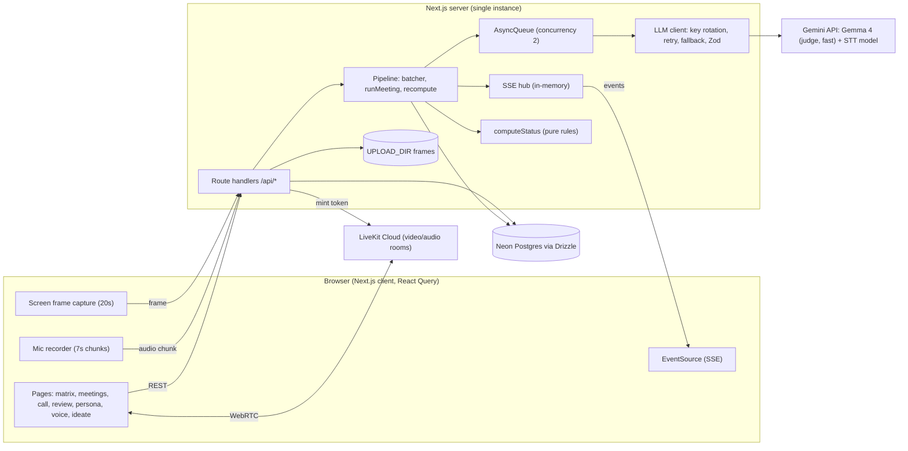
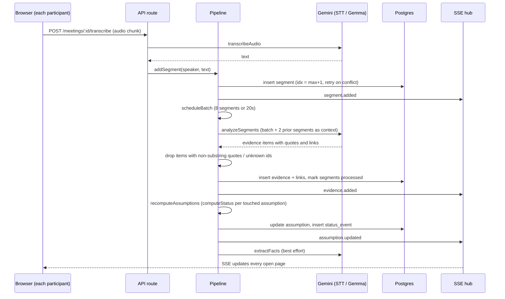
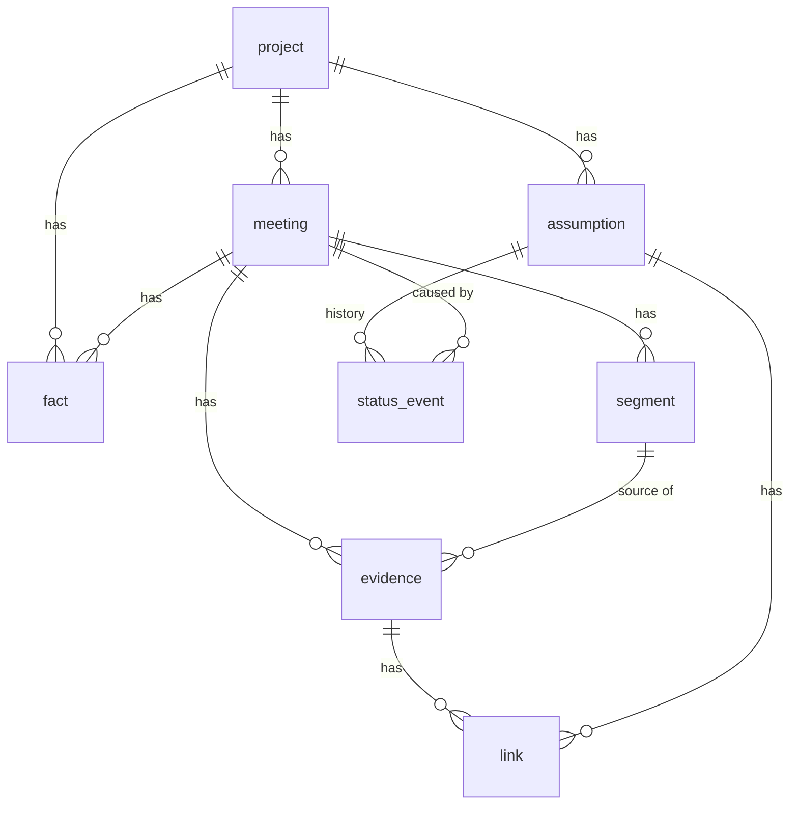

# Assumption Ledger

Declare product assumptions, run customer interviews as live video calls (or import transcripts), and watch each assumption move to `validated`, `invalidated`, `mixed`, or `untested`, with a verbatim quote behind every status.

The core design rule: **the model only extracts and classifies evidence. It never decides status.** Status is computed by deterministic, unit-tested rules in `src/server/status.ts`.

## Contents

1. [Requirements](#requirements)
2. [Architecture](#architecture)
3. [Key design decisions](#key-design-decisions)
4. [Known limitations and next steps](#known-limitations-and-next-steps)
5. [Setup](#setup)
6. [Project layout](#project-layout)
7. [3 minute demo](#3-minute-demo)

---

## Requirements

### Functional requirements

| ID | Requirement |
| --- | --- |
| FR1 | Create projects. A project holds up to 30 assumptions, typed as desirability, feasibility, or viability, with a risk score and owner. |
| FR2 | Draft assumptions from a product description (`/assumptions/draft`) and map an idea to ranked assumptions with falsification criteria and test plans (`/ideate`, `/assumptions/map`). Mapped assumptions are not saved until the user accepts them. |
| FR3 | Run an interview as a live video call. Each meeting has an invite link (`/join/<code>`); guests enter a name and join. |
| FR4 | Transcribe each participant's speech live and store it as ordered segments. |
| FR5 | Import an existing transcript as a meeting (`/meetings/import`). |
| FR6 | Extract evidence from segments: a claim, a verbatim quote, and links to assumptions with stance (supports, contradicts, neutral) and strength. |
| FR7 | Extract evidence from shared screens. Frames are captured every 20 seconds and described by a vision model. |
| FR8 | Compute assumption status and confidence from linked evidence. Record every change as a `status_event` with a human-readable reason. |
| FR9 | Push all changes (segments, evidence, status, pipeline state) to every open page in real time. |
| FR10 | Review a meeting after it ends: accept or reject evidence, override links, see status changes, token usage, and a Markdown export. |
| FR11 | Gap matrix: show which assumptions lack evidence and suggest interview questions for them (`/matrix`, `/questions`). |
| FR12 | Build an evidence-based customer persona from non-rejected evidence, using verbatim quotes only (`/persona`). |
| FR13 | Extract customer facts (behavior, pain, goal, language, constraint, tone) with reusable phrases and a cheap outbound test, then synthesise a voice and phrasebook for copy (`/voice`). |

### Non-functional requirements

| ID | Category | Requirement | How it is met |
| --- | --- | --- | --- |
| NFR1 | Trustworthiness | No fabricated evidence. Every evidence item is traceable to something a customer actually said. | Code drops any model item whose quote is not a substring of the source segment, and any link to an unknown assumption id. Persona quotes and voice phrases get the same check. |
| NFR2 | Explainability | A status must be defensible. | Deterministic `computeStatus` with named thresholds. Each transition stores a reason such as "6 support from 3 speakers, 1 against from 1". |
| NFR3 | Bias resistance | One loud participant must not decide the outcome. | Per-speaker net score is clamped to ±3. `validated` needs 3 distinct speakers, `invalidated` needs 2. |
| NFR4 | Latency | Evidence appears within seconds of speech. | 7 s audio chunks, batches of 8 segments or 20 s (whichever first), SSE push. Fast model for extraction, thinking only where needed. |
| NFR5 | Reliability of LLM calls | Transient provider failures must not lose data. | Round-robin across multiple API keys, up to 4 attempts with exponential backoff and jitter on 429/5xx/network errors, 30 s timeout, optional fallback model, one validation-repair retry. Facts extraction failing never blocks evidence. |
| NFR6 | Graceful degradation | Model capability differences must not break the app. | Auto-detects unsupported JSON mode or thinking levels, disables them for the process, and retries. `parseJsonLoose` tolerates fenced or noisy output. |
| NFR7 | Consistency | Concurrent speakers must not corrupt ordering or double-process. | `unique(meeting_id, idx)` with retry on conflict in `addSegment`. One `runMeeting` per meeting at a time. `unique(evidence_id, assumption_id)` with `onConflictDoNothing`. |
| NFR8 | Cost control | Bounded and visible LLM spend. | Concurrency-2 job queue, batching, silent audio chunks skipped, image frames uploaded only when changed. Input tokens, output tokens, and call count tracked per meeting. |
| NFR9 | Type safety | Boundaries are validated. | Zod on env, request bodies, and every model response. Drizzle schema is the source of truth for DB types. |
| NFR10 | Testability | Core logic runs without network. | `computeStatus` is a pure function with unit tests (`npm test`). |
| NFR11 | Operability | Easy to run and debug. | Single deployable. `GET /api/health`. `npm run llm:check` and `scripts/stt-check.ts` probe providers. Failures are persisted on the meeting (`job_status`, `job_error`) and surfaced over SSE. |
| NFR12 | Scalability target | Demo and small-team scale, not multi-tenant SaaS. | See [limitations](#known-limitations-and-next-steps). |

---

## Architecture

### System context



### Live interview data flow



### Status rules

`computeStatus` input is the set of non-rejected, non-neutral links. Per-speaker net strength is clamped to ±3, then summed into `support` and `contradict`.

| Status | Rule |
| --- | --- |
| `untested` | No counted links. |
| `invalidated` | `contradict >= 3`, from `>= 2` speakers, and `support <= 0.34 * contradict`. |
| `validated` | `support >= 6`, from `>= 3` speakers, and `contradict <= 0.2 * support`. |
| `mixed` | Both sides present and `min/max >= 0.4`. |
| `supporting` / `contradicted` | Otherwise, whichever side is larger. |

Confidence is `min(1, total / 10) * (larger side / total)`. All thresholds live in `STATUS_THRESHOLDS`.

### Data model



`link` is the join between evidence and assumptions and carries `stance`, `strength` (1 to 3), `rationale`, `origin` (model or user), and `rejected`. Humans override the model by flipping `rejected` or adding a `user` link, then status is recomputed. `status_event` is an append-only audit log.

---

## Key design decisions

| # | Decision | Why | Trade-off |
| --- | --- | --- | --- |
| 1 | **LLM extracts, code decides.** The model returns claim, quote, stance, and strength. Status comes from `computeStatus`. | Verdicts must be reproducible, explainable, and testable. A model asked "is this validated?" drifts between runs. | Thresholds are opinionated and need tuning against real interviews. |
| 2 | **Verbatim quote guard.** Reject evidence whose quote is not a substring of the segment. Same for persona quotes and voice phrases. | Hard defence against hallucination. Every status can be traced to real words. | Lightly paraphrased or mis-transcribed quotes are dropped (false negatives over false positives). Matching uses normalisation (`norm`). |
| 3 | **Per-speaker clamping and distinct-speaker minimums.** | One enthusiastic interviewee should not validate an assumption on their own. | Needs several interviews before `validated` is reachable. Intended. |
| 4 | **Skeptical-researcher prompt.** Past behavior and numbers are strong evidence, hypotheticals are weak. | Customers say they would buy. Stated intent is a poor signal. | Strength grading is still model judgment. Users can reject or override each link. |
| 5 | **Single Next.js app, route handlers instead of a separate backend.** | One deploy, shared types, minimal ops for the scope. | Long jobs live inside the web process (see decision 8). |
| 6 | **Drizzle on Neon Postgres, pooled connection.** | Relational integrity (cascades, unique constraints) fits evidence graphs. Typed schema and generated SQL migrations. Serverless-friendly Postgres. | Requires network round trips per query. Pool capped at 8. |
| 7 | **LiveKit for video. Transcription is server-side via cloud STT, not browser speech APIs.** Each participant records their own mic. | Browser SpeechRecognition is inconsistent across browsers and cannot be attributed to a remote speaker. Per-participant capture gives clean speaker labels for free. | A Gemini STT model is used, so the stack is not strictly Gemma-only. `transcribeAudio` is the single seam to swap. 7 s chunks add latency. |
| 8 | **In-process `AsyncQueue` (concurrency 2) and `setTimeout` batching instead of a job broker.** State is pinned to `globalThis` to survive dev hot reload. | No extra infrastructure. Concurrency cap protects API quotas. | Jobs are lost on restart and cannot scale horizontally. Unprocessed segments are still in the DB (`processed = false`) so work is resumable by `reprocess`. |
| 9 | **Server-Sent Events, not WebSockets.** In-memory hub keyed by project. | Traffic is one-way server to client. SSE is simple, proxies well, and auto-reconnects (`retry: 3000`, 15 s heartbeat). | Hub is in-memory, so one server instance only. Replace with Postgres LISTEN/NOTIFY or Redis to scale out. |
| 10 | **Batching by size or time (8 segments or 20 s) with 2 segments of prior context.** | Balances cost and latency. Context lets the model resolve pronouns and follow-ups. | Evidence can lag a few seconds. A meeting end calls `flushMeeting` to drain the rest. |
| 11 | **LLM client hardened centrally.** Key rotation, backoff with jitter, timeout, fallback model, feature auto-detection, and Zod validation with one repair retry. | Free-tier keys rate-limit. Hosted models return 5xx. Output shape is unreliable. Handling it in one place keeps tasks simple. | Process-wide flags (`__jsonMode`, `__thinkingOk`) are global, which is fine for one provider. |
| 12 | **Two model tiers.** Judge model (`GEMMA_MODEL_JUDGE`) for synthesis, fast model (`GEMMA_MODEL_FAST`) for high-frequency extraction. | Cost and latency where it matters. Quality where it matters. | Two configs to tune. |
| 13 | **Human in the loop.** Evidence can be accepted or rejected, links overridden, and generated assumptions are previewed before saving. | The tool informs decisions, it does not make them. | Extra review step. |
| 14 | **Append-only `status_event` plus per-meeting token accounting.** | Audit trail, "what changed because of this call", and cost transparency. | Extra writes per change. |
| 15 | **Idempotent seed and `onConflictDoNothing` on links.** | Safe re-runs, safe reprocessing. | None significant. |

---

## Known limitations and next steps

Honest list of what is deliberately out of scope for the current stage.

- **No authentication or authorization.** Anyone with a project URL can read and write it. Invite codes gate meeting join only. Add auth and per-project ownership before any real use.
- **Single instance only.** SSE hub, queue, and batch timers are in memory.
- **Uploads on local disk** (`UPLOAD_DIR`) served through `/api/uploads/:name`. Move to object storage for multi-instance or serverless.
- **Rate limiting is basic.** `rateLimit` in `src/server/http.ts` guards transcribe, frames, and segments, but it is per process and in memory.
- **Thresholds are untuned.** `STATUS_THRESHOLDS` should be calibrated on real interviews.
- **Limited test coverage.** Only `computeStatus` is unit tested. Pipeline and LLM task guards are good candidates next.
- **Scale-out path:** Postgres-backed job table or a broker, LISTEN/NOTIFY or Redis pub/sub for events, S3-compatible storage, auth, and per-key quota tracking.

---

## Setup

```bash
npm install
cp .env.example .env.local     # then fill in values
npm run db:migrate             # applies drizzle/ migrations to Neon
npm run seed                   # demo project, runs real model analysis
npm run dev                    # http://localhost:3000
```

### Services

1. **Neon**: create a project, copy the pooled connection string into `DATABASE_URL`.
2. **LiveKit Cloud**: create a project, copy URL, API key, and secret into `LIVEKIT_URL`, `LIVEKIT_API_KEY`, `LIVEKIT_API_SECRET`. Set `NEXT_PUBLIC_LIVEKIT_URL` to the same URL.
3. **Gemini API**: create a key at https://aistudio.google.com/apikey and put one or more comma separated keys in `GEMINI_API_KEYS`. Keys rotate round robin with retry on 429 and 5xx. Model IDs are `GEMMA_MODEL_JUDGE`, `GEMMA_MODEL_FAST`, and `STT_MODEL` (default `gemini-3.5-flash-lite`).

### Environment variables

| Variable | Required | Default | Purpose |
| --- | --- | --- | --- |
| `DATABASE_URL` | yes | | Postgres connection string |
| `GEMINI_API_KEYS` | yes for AI features | | Comma separated, rotated round robin |
| `GEMMA_MODEL_JUDGE` | no | `gemma-4-31b-it` | Synthesis, persona, voice, mapping |
| `GEMMA_MODEL_FAST` | no | `gemma-4-26b-a4b-it` | Per-batch extraction |
| `STT_MODEL` | no | `gemini-3.5-flash-lite` | Speech to text |
| `LIVEKIT_URL`, `LIVEKIT_API_KEY`, `LIVEKIT_API_SECRET` | for calls | | Server-side token minting |
| `NEXT_PUBLIC_LIVEKIT_URL` | for calls | | Client connection URL |
| `UPLOAD_DIR` | no | `./uploads` | Screen frame storage |

### Scripts

| Command | Purpose |
| --- | --- |
| `npm run dev` / `build` / `start` | Next.js lifecycle |
| `npm run db:generate` | Generate a migration after editing `src/server/db/schema.ts` |
| `npm run db:migrate` | Apply migrations |
| `npm run seed` | Idempotent demo data |
| `npm run llm:check` | Call the vision task once, print JSON and detected JSON mode |
| `npm test` | Unit tests for `computeStatus` |
| `npm run typecheck` | TypeScript check |
| `npm run lint` | ESLint |

---

## Project layout

```
src/
  app/
    api/            Route handlers (projects, assumptions, meetings, livekit, uploads, health)
    p/[projectId]/  Project pages: matrix, meetings, assumptions/new, persona, ideate, voice
    m/[meetingId]/  Live call and post-call review
    join/[code]/    Guest entry via invite link
  components/       App shell, nav, dialogs, evidence drawer, idea-map results, ui primitives
  lib/              Client API helpers, Zod schemas, SSE hook, status display metadata
  server/
    db/             Drizzle pool and schema
    llm/            Gemini client, task functions, prompts
    pipeline.ts     Segment batching, evidence storage, status recompute, frame processing
    status.ts       Deterministic status rules (pure)
    queue.ts        In-process job queue
    sse.ts          In-memory event hub
    queries.ts      Shared read helpers
drizzle/            Generated SQL migrations
scripts/            migrate, seed, llm-check, stt-check
```

---

## 3 minute demo

1. **0:00** Create a project (or open the seeded "Meal planning app for busy parents").
2. **0:30** Open Matrix. Point at gap rows, then press "Suggest questions".
3. **1:00** Meetings tab, "Start live call". Copy the invite link, join from a second window.
4. **1:30** Say a supporting line: "Every night I stand in front of the fridge with no idea what to cook." Then a contradicting line from the other window: "We plan all seven dinners on Sunday and stick to it."
5. **2:00** Watch Evidence and Assumptions tabs update. Share a slide with text on it; image evidence appears.
6. **2:30** End call. Review page shows status changes with reasons, evidence accept or reject, token counts, Markdown export.
