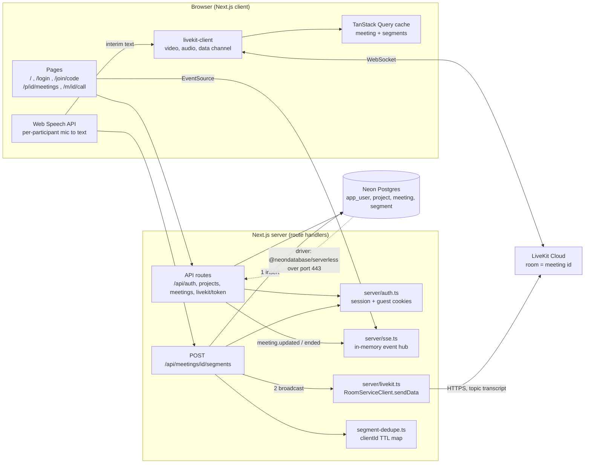
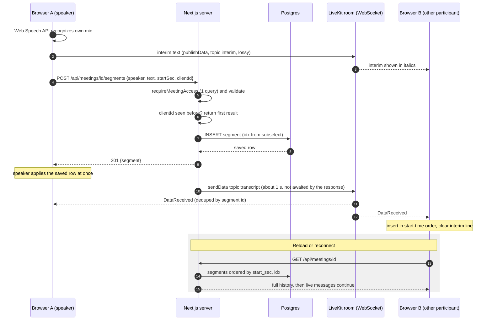
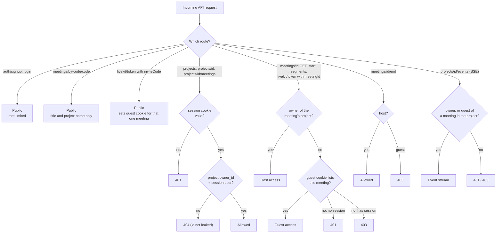
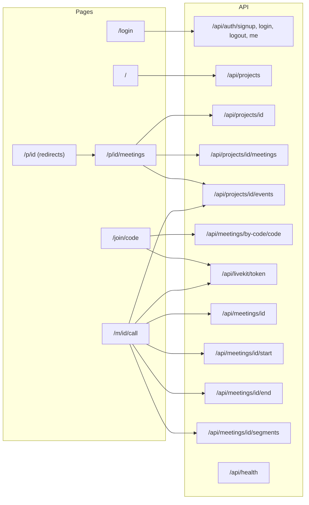
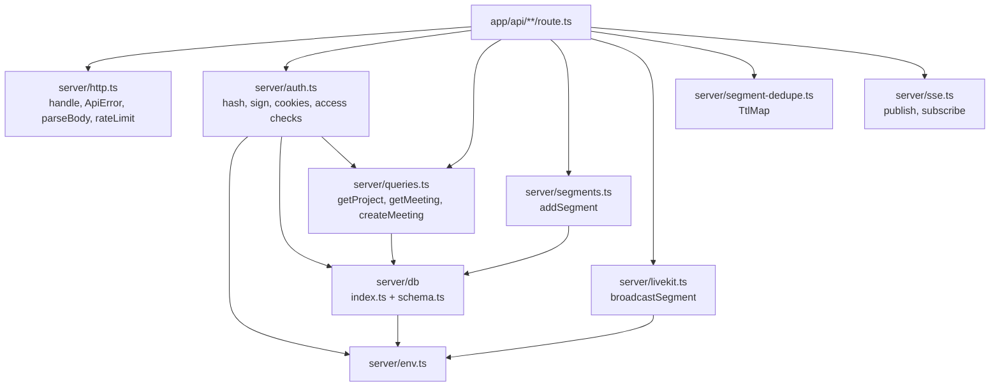
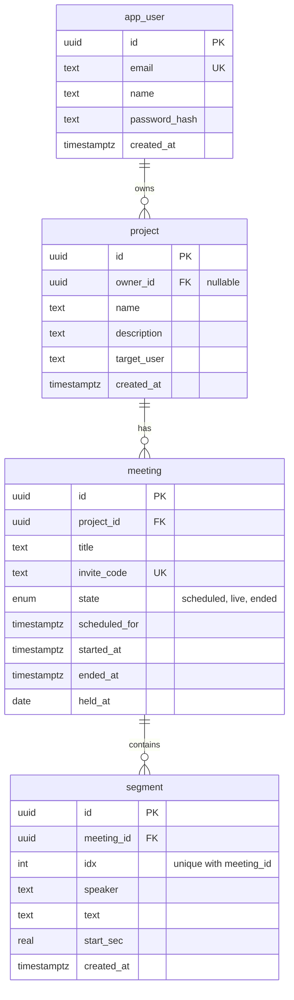
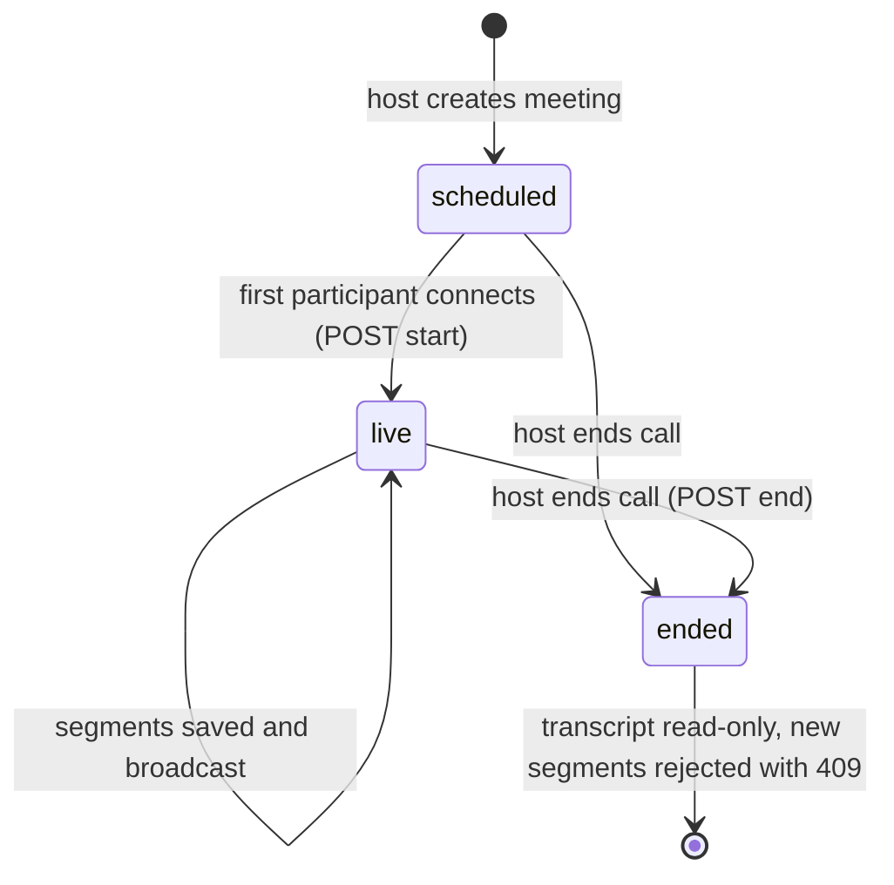

# Architecture diagrams

Current code: projects, meetings (LiveKit video call with invite link), and live transcripts. Diagrams are Mermaid and render on GitHub and in most editors.

## 1. System overview

## 2. Live transcript flow

Final phrases are saved first, then broadcast. Interim text is display only and never stored.

## 3. Authentication and authorization

## 4. Page and route map

## 5. Server modules

## 6. Data model (tables in use)

Other tables from the earlier product (assumption, evidence, link, fact, status_event) still exist in the database but no code uses them.

## 7. Meeting lifecycle

